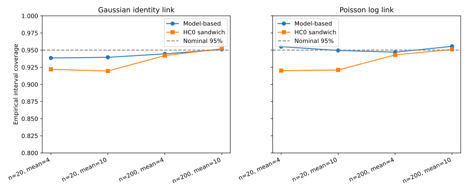

# Count Model Simulation

A self-contained Monte Carlo experiment comparing Poisson regression with a log link and Gaussian regression with an identity link on simulated count data.

## Features

- Generates independent binary predictors and Poisson outcomes using a configurable seed.
- Runs four scenarios: sample sizes 20 and 200, with Poisson means 4 and 10.
- Fits both models using exact group-based formulas for an intercept and binary predictor.
- Compares model-based and HC0 sandwich variance estimates.
- Measures empirical 95% interval coverage, slope variance and mean-estimation bias.
- Reports Monte Carlo standard errors, successful replications and skipped boundary cases.
- Exports CSV results, JSON settings and an SVG coverage chart.

## Run

Requires Python 3.10 or later. No external dataset is needed.

```bash
python -m pip install -r requirements.txt
python simulate.py --repetitions 2000 --seed 123 --output results
python -m unittest -v
python verify.py
```

## Experiment

Each scenario uses 2,000 independently generated datasets. Predictors follow Bernoulli(0.5); outcomes follow Poisson with a constant mean independent of the predictor. The true slope is zero for both models. Both models include an intercept and reproduce the two observed group means. Their overall fitted mean equals the sample mean, so their mean-bias results coincide.

The Poisson slope is a log mean ratio; the Gaussian slope is a difference in means. Their raw slope variances are on different scales and should not be interpreted as a direct efficiency ranking.

Intervals use the fitted slope plus or minus 1.959964 standard errors. Coverage is the fraction containing the true slope, zero. Gaussian model-based variance uses residual degrees of freedom n−2. HC0 uses squared residuals without a small-sample correction. Coverage Monte Carlo standard error is sqrt(p(1−p)/B), where B is the successful replication count.

A replicate is skipped for both models if either predictor group is absent or has an outcome total of zero, where a finite Poisson log-ratio estimate is unavailable. The settings file records these counts; the included run has zero skipped replicates.

## Results

| Sample size | Poisson mean | Poisson model coverage | Poisson HC0 coverage | Gaussian model coverage | Gaussian HC0 coverage |
|---|---|---|---|---|---|
| 20 | 4 | 95.50% | 92.00% | 93.85% | 92.20% |
| 20 | 10 | 94.95% | 92.10% | 93.95% | 91.95% |
| 200 | 4 | 94.70% | 94.30% | 94.45% | 94.20% |
| 200 | 10 | 95.55% | 95.10% | 95.10% | 95.20% |



In this run, HC0 intervals show lower-than-nominal coverage at n=20 and coverage nearer 95% at n=200. These findings concern this constant-mean simulation; they do not demonstrate behavior under overdispersion, omitted predictors or nonzero effects. Monte Carlo variation remains, with coverage standard errors of roughly 0.5–0.6 percentage points.

## Files and validation

- `simulate.py`: simulation, model formulas, summaries and chart.
- `test_simulate.py`: five tests covering known results, matrix equivalence, invalid inputs and reproducibility.
- `verify.py`: independent matrix-based variance checks on 100 datasets.
- `results/simulation_summary.csv`: eight scenario/model summaries.
- `results/settings.json`: seed, replication counts and skipped cases.
- `results/coverage.svg`: coverage comparison.

The experiment uses synthetic data throughout. Repeating the run in the same numerical environment with the same seed reproduces the results.
